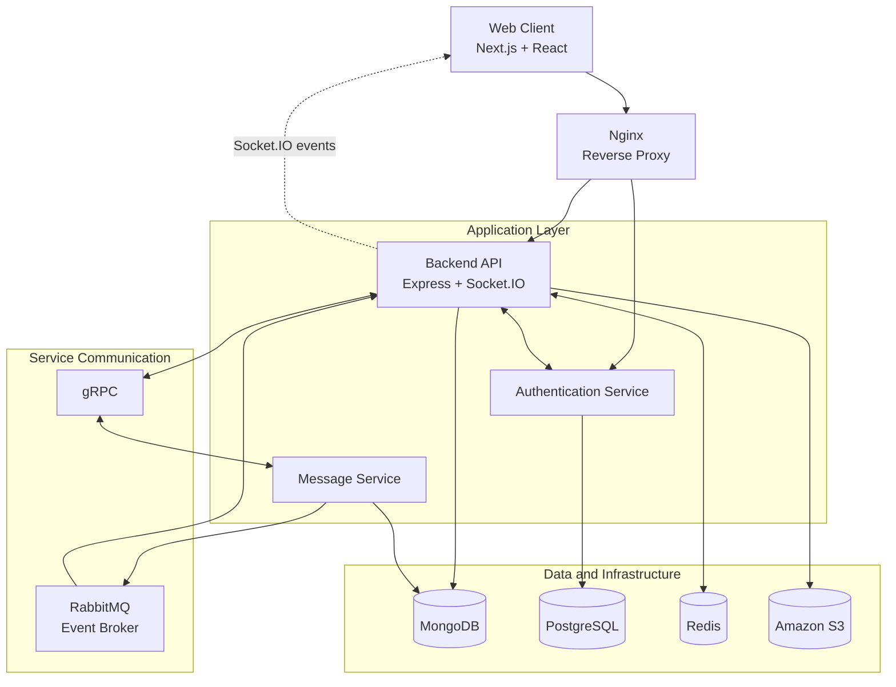

# Melo — Real-Time Messaging Platform

**A real-time messaging platform built with the MERN ecosystem, TypeScript, and distributed backend services.**

Melo is a full-stack messaging application designed to explore real-world backend engineering concepts, including service separation, asynchronous event-driven communication, real-time messaging, caching, authentication, and containerized deployment.

The project combines a modern web interface with a distributed backend architecture using REST APIs, Socket.IO, gRPC, RabbitMQ, Redis, and Docker.

## Overview

Melo provides a foundation for real-time communication while exploring how backend services can be separated into independent components with clearly defined responsibilities.

Rather than relying entirely on a single application server, Melo uses synchronous communication for service-to-service operations and asynchronous messaging for events that can be processed independently.

### Key highlights

- Real-time messaging using Socket.IO.
- Modular backend services built with Node.js and TypeScript.
- REST APIs for client-to-server communication.
- gRPC for synchronous internal service communication.
- RabbitMQ for asynchronous, event-driven messaging.
- Redis for caching and ephemeral application state.
- MongoDB and PostgreSQL for persistence.
- Docker-based service orchestration.
- Nginx for reverse proxying and request routing.
- Structured logging and automated tests.

## Features

### Messaging and conversations

- Real-time message delivery.
- Create and manage conversations.
- Direct and group conversations.
- Message creation, editing, and deletion.
- Message reactions.
- Read receipts and unread-message updates.
- User mentions in conversations.
- File sharing.
- Group conversation management.

### Authentication and security

- Dedicated authentication service.
- Access and refresh token utilities.
- Cookie-based authentication.
- OTP-based authentication flows.
- Protected API endpoints.
- Environment-based configuration for sensitive credentials.

### Real-time communication

- Persistent Socket.IO connections for real-time client updates.
- RabbitMQ events for message-related workflows.
- Backend event consumers that dispatch real-time updates to connected clients.
- Separation between message processing and real-time event delivery.

### Media and file handling

- File upload support.
- Amazon S3 integration.
- Signed URLs for supported upload workflows.
- Backend endpoints for file-related operations.

### Engineering and operations

- TypeScript across the application.
- Dockerized application services.
- Docker Compose orchestration.
- Nginx reverse proxy configuration.
- Structured application logging.
- Unit and integration-oriented tests using Vitest.

## Technology stack

| Category | Technologies |
|---|---|
| Frontend | Next.js, React, TypeScript |
| Styling | Tailwind CSS |
| Backend | Node.js, Express.js, TypeScript |
| Real-time communication | Socket.IO |
| Synchronous service communication | gRPC, Protocol Buffers |
| Asynchronous messaging | RabbitMQ |
| Caching and ephemeral state | Redis |
| Document database | MongoDB, Mongoose |
| Relational database | PostgreSQL |
| Object storage | Amazon S3 |
| Authentication | JWT, cookies, OTP flows |
| Testing | Vitest |
| Containers | Docker, Docker Compose |
| Reverse proxy | Nginx |
| Deployment | Linux, Google Cloud Compute Engine |

## Architecture

Melo separates client-facing operations, authentication, message processing, and infrastructure responsibilities into distinct components.

### High-level architecture



*The diagram illustrates the major architectural components and intended communication paths. Exact database ownership, gRPC call paths, and service connections should be aligned with the current implementation.*

### Architectural responsibilities

**Frontend**

The Next.js application provides the user interface and communicates with backend services through HTTP APIs and real-time connections.

**Backend API and real-time gateway**

The Express backend handles client-facing operations and maintains Socket.IO connections. It consumes relevant message events from RabbitMQ and dispatches real-time updates to connected clients.

**Authentication service**

The authentication service isolates authentication-related logic and integrates with PostgreSQL for relational persistence.

**Message service**

The message service handles message-related operations and publishes domain events to RabbitMQ so that other components can react without requiring every operation to execute synchronously.

**gRPC**

gRPC and Protocol Buffers provide structured contracts for synchronous communication between backend services.

**RabbitMQ**

RabbitMQ acts as the asynchronous event broker. Message-related events include:

- `message.created`
- `message.unread-update`
- `message.seen`

The backend consumes relevant events and forwards updates through Socket.IO.

**Redis**

Redis supports caching and short-lived application state, including authentication-related data and presence tracking where configured.

**Data persistence and object storage**

MongoDB stores document-oriented application data, PostgreSQL supports relational authentication data, and Amazon S3 provides object storage for supported media workflows.

## Communication patterns

Melo uses different communication mechanisms depending on the requirement.

| Pattern | Technology | Purpose |
|---|---|---|
| Client to backend | REST / HTTP | API requests and application operations |
| Client to server | Socket.IO | Real-time communication |
| Service to service | gRPC | Synchronous internal operations |
| Service to service | RabbitMQ | Asynchronous domain events |
| Application to cache | Redis | Caching and ephemeral state |
| Application to database | MongoDB / PostgreSQL | Persistent data storage |
| Application to object storage | Amazon S3 | Media and file storage |

### Example: Message event flow

1. A client sends a message-related request to the backend.
2. The message service processes the operation.
3. The service publishes a corresponding event to RabbitMQ.
4. The backend consumes the event.
5. The backend dispatches the appropriate Socket.IO update to connected clients.

This approach separates message processing from real-time event delivery and provides a foundation for evolving the services independently.

## Project structure

The exact directory layout may vary by repository. A conceptual view of the project is:

```text
melo/
├── frontend/             # Next.js web application
├── backend/              # Express API and Socket.IO gateway
├── auth-service/         # Authentication service
├── message-service/      # Message processing and event publishing
├── proto/                # Protocol Buffer service contracts
├── docker-compose.yml    # Container orchestration
├── nginx/                # Reverse proxy configuration
├── .gitignore
└── README.md
```

Update the directory names above to match the actual repository structure.

## Getting started

### Prerequisites

Install the following tools before running Melo locally:

- [Node.js](https://nodejs.org/)
- [Docker](https://www.docker.com/)
- [Docker Compose](https://docs.docker.com/compose/)
- Git

You will also need the relevant database, broker, object-storage, and authentication configuration for the services enabled in your deployment.

### 1. Clone the repository

```bash
git clone <YOUR_REPOSITORY_URL>
cd melo
```

### 2. Configure environment variables

Create the environment files required by the individual services.

Depending on the current configuration, these may include:

- Frontend environment variables.
- Backend API environment variables.
- Authentication service environment variables.
- Message service environment variables.

Use the repository's example environment files as the source of truth.

Typical configuration categories include:

| Category | Purpose |
|---|---|
| Database URLs | MongoDB and PostgreSQL connections |
| Redis configuration | Cache and ephemeral-state connectivity |
| RabbitMQ configuration | Broker URL, exchanges, and queues |
| Authentication secrets | Token signing and authentication configuration |
| Frontend configuration | Public API and application URLs |
| Object storage | S3 bucket, region, and credential configuration |
| Email delivery | SMTP credentials for OTP delivery |
| Service networking | Internal HTTP and gRPC endpoints |

**Never commit `.env` files, access tokens, database credentials, SMTP app passwords, or cloud credentials to version control.**

### 3. Start the application

If the repository's Docker Compose configuration is at the project root and the required environment files are configured:

```bash
docker compose up --build -d
```

Check the status of the containers:

```bash
docker compose ps
```

Inspect the logs:

```bash
docker compose logs -f
```

To inspect a specific service:

```bash
docker compose logs -f backend
```

Use the actual service names defined in `docker-compose.yml` if they differ from these examples.

### 4. Access the application

Open the frontend using the local URL configured by the project.

For a Docker deployment, the available ports and public entry point depend on the Compose and Nginx configuration.

Verify that:

- The frontend loads correctly.
- Authentication requests reach the appropriate service.
- Database connections are established.
- Redis and RabbitMQ are reachable.
- Real-time connections succeed.
- Message events are processed and delivered correctly.

### 5. Stop the application

```bash
docker compose down
```

This stops and removes the Compose-managed containers and network. Persistent volumes are not removed unless explicitly requested.

## Testing

Melo uses Vitest for automated testing.

Run tests from the relevant service directory using the scripts defined in its `package.json`.

For example, where supported:

```bash
npm install
npm test
```

To execute Vitest directly:

```bash
npx vitest run
```

Test coverage should include areas such as:

- Authentication and authorization.
- OTP workflows.
- Protected routes and middleware.
- Message-processing logic.
- Error handling.
- Event publishing and consumption.
- Repository implementations.

The exact test commands and coverage depend on the scripts configured in each service.

## Deployment

Melo has been containerized for deployment on a Linux virtual machine using Docker Compose.

The deployment architecture uses:

- A Linux host running the application containers.
- Nginx as the reverse proxy.
- Docker networking for internal service communication.
- Redis and RabbitMQ for supporting application workflows.
- MongoDB and PostgreSQL for persistent storage.
- Environment-based configuration for production secrets.

### Production considerations

Before exposing a deployment publicly, verify:

- HTTPS and TLS configuration.
- Firewall and cloud security rules.
- Internal services are not unnecessarily exposed to the public internet.
- Database and broker credentials are secured.
- Persistent storage and backups are configured.
- Health checks and restart policies are appropriate.
- Logs are useful for troubleshooting without leaking secrets.
- WebSocket upgrades and reverse proxy timeouts are configured correctly.

For production use, database backups, monitoring, resource limits, and a tested recovery procedure should also be considered.

## Engineering decisions

### Separating synchronous and asynchronous operations

gRPC is used for operations that require a direct service response, while RabbitMQ supports event-driven workflows that can be processed asynchronously.

This separates request-response communication from downstream event handling.

### Dedicated authentication service

Authentication responsibilities are isolated from the primary client-facing backend, providing clearer service boundaries and a foundation for independent evolution.

### Redis for short-lived state

Redis provides a suitable mechanism for caching and ephemeral application data without requiring every read or state update to access persistent storage.

### Containerized deployment

Docker and Docker Compose make it easier to configure and run multiple services within a consistent environment.

### Real-time delivery through Socket.IO

Socket.IO handles client-facing real-time communication, while message-related events can be published and consumed independently through RabbitMQ.

This separation helps keep event processing and client notification responsibilities distinct.

## Current scope and future improvements

Potential areas for further development include:

- Automated CI/CD pipelines.
- Centralized metrics and distributed tracing.
- More comprehensive integration and end-to-end tests.
- Automated database backup and recovery workflows.
- Improved service health checks and dependency readiness checks.
- Dead-letter queue monitoring and retry observability.
- Load testing for message throughput and concurrent connections.
- Improved deployment automation and infrastructure management.

These are potential improvements, not a claim that every item is already implemented.

## Contributing

Contributions, suggestions, and bug reports are welcome.

1. Fork the repository.
2. Create a feature branch.
3. Implement and test your changes.
4. Submit a pull request describing the changes.

Please avoid committing secrets, generated artifacts, or unrelated changes.

## License

Choose and add a license before distributing or accepting contributions under a specific license. Until then, the repository's reuse and redistribution terms remain unspecified.

## Author

**Adithyan Valloor**

- Melo live: [melo.adithyanvalloor.com](http://melo.adithyanvalloor.com)
- Portfolio: [adithyanvalloor.com](https://adithyanvalloor.com)
- GitHub: [GitHub profile](https://github.com/<YOUR_GITHUB_USERNAME>)
- LinkedIn: [LinkedIn profile](https://www.linkedin.com/in/<YOUR_LINKEDIN_USERNAME>/)


---

*Melo is a full-stack engineering project focused on real-time communication, distributed backend design, and production-oriented deployment practices.*
